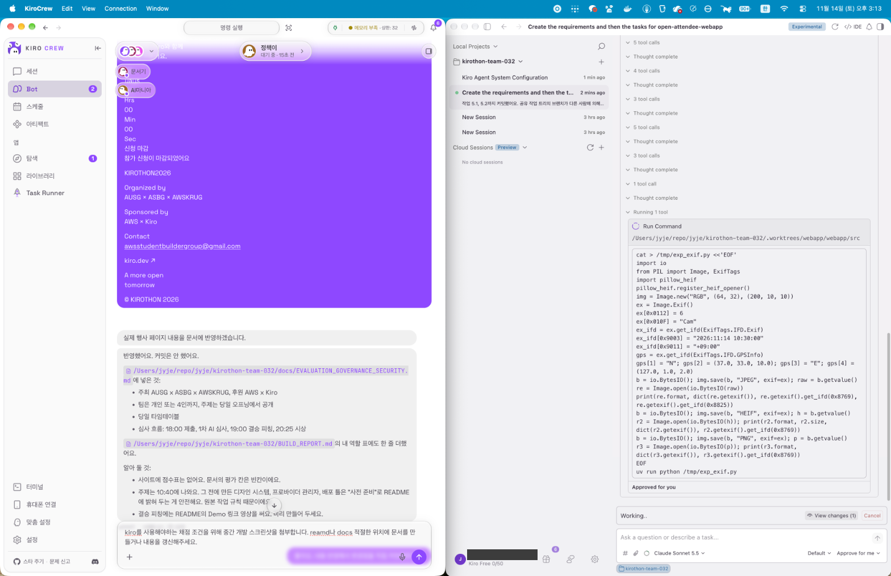
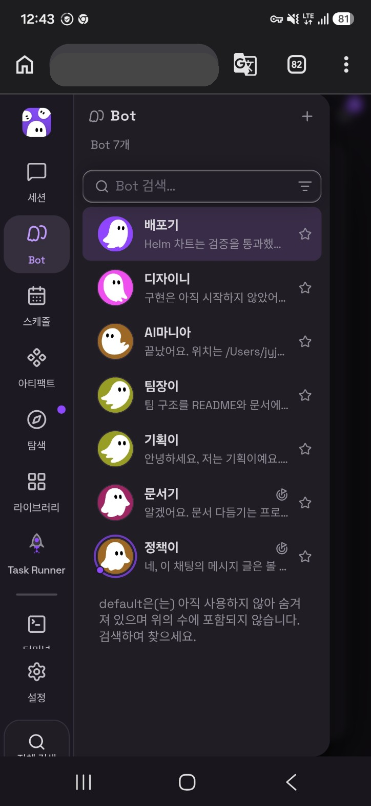

# Kiro 활용 증거

심사의 "Kiro 활용" 항목을 위한 기록이에요. 개발 중간에 찍은 화면과, 그 화면이 가리키는 저장소 증거를 함께 적어요.
단계별 표는 [`BUILD_REPORT.md`](../BUILD_REPORT.md)에 있어요.

## 1. 중간 개발 스크린샷 (2026-11-14 15:13 KST)

개인정보 보호를 위해 계정 이메일은 가렸어요.

| 화면 | 보이는 것 |
|---|---|
| 왼쪽: **Kiro Crew** | Bot 여러 개(문서기, AI마니아, 정책이 등)가 한 팀으로 일해요. 내 Bot에게 문서 작업을 맡기고 결과를 받는 중이에요 |
| 오른쪽: **Kiro IDE** | 프로젝트 `kirothon-team-032`의 에이전트 세션 "Create the requirements and then the tasks for open-attendee-webapp". 요구사항에서 작업 목록으로 이어지는 **스펙 주도 개발** 흐름이에요 |
| 오른쪽 아래 | 에이전트가 명령을 실행하는 중(`Running 1 tool`). 사람이 `Approved for you`로 승인한 명령이에요. 작업 위치는 `.worktrees/webapp/webapp/src` |
| 오른쪽 위 | `Thought complete`와 `tool calls`가 이어져요. 에이전트가 생각하고 도구를 부르는 과정이에요 |

## 1-2. 모바일 개발 스크린샷 (2026-11-14 12:43 KST)

쉬는 시간에 이동하면서 휴대폰으로 개발을 이어갔어요. 접속 주소(테일넷 이름)는 가렸어요.

| 화면 | 보이는 것 |
|---|---|
| 접속 방법 | 집 컴퓨터의 **Kiro Crew**에 **Tailscale** 주소로 휴대폰 브라우저에서 접속. 자리에 없어도 같은 Bot과 대화해요 |
| Bot 7개 | 배포기, 디자이니, AI마니아, 팀장이, 기획이, 문서기, 정책이 |
| 목록의 한 줄 | 각 Bot이 마지막에 한 일이 보여요. 예: 배포기 "Helm 차트는 검증을 통과했…", 팀장이 "팀 구조를 README와 문서에…" |
| 하단 메뉴 | 세션, Bot, 스케줄, 아티팩트, 탐색, 라이브러리, Task Runner, 터미널, 설정 |

- 컴퓨터가 일을 하는 동안 사람은 이동 중에 확인하고 지시해요.
- 접속은 Tailscale 사설망 안에서만 열려요. 공개 인터넷에 열지 않아요.

## 2. 쓴 Kiro 기능

| 기능 | 어디에 썼나 | 증거 |
|---|---|---|
| Spec (requirements, design, tasks) | 웹앱 `open-attendee-webapp` 기획에서 작업 목록까지 | 커밋 `44f7bc6` "웹앱 요구사항, 설계, 작업 목록 추가", `.kiro/specs/open-attendee-webapp/` |
| 에이전트 세션 (Kiro IDE) | 스펙에 따른 구현. 작업 번호(예: 5.1)별로 커밋 | `crew/webapp/open-attendee` 브랜치의 커밋 이력 |
| Kiro Crew 멀티 에이전트 | 역할을 나눈 Bot이 병렬로 일함 (아래 표) | `BUILD_REPORT.md`의 "AI 에이전트 역할과 성과" |
| Kiro Crew 게이트웨이 + Tailscale | 휴대폰으로 이동 중에도 Bot에게 일을 맡기고 확인 | 위 모바일 스크린샷 |
| 에이전트 스킬 | 디자인 시스템, 커밋 메시지 검증, README 작성 | `.agents/skills/` |
| 작업 규칙 (steering 역할) | Bot이 작업 전에 읽는 팀 규칙 | `AGENTS.md` |

### Kiro Crew의 Bot 역할

| Bot | 역할 | 결과물 |
|---|---|---|
| 정책이 | 평가, 거버넌스, 보안 문서 | `docs/EVALUATION_GOVERNANCE_SECURITY.md` |
| 팀장이 | 팀 구조 정리 (README와 문서) | 모바일 화면의 최근 작업 줄 기준. 결과물 위치는 확인 못 함 |
| 기획이 | 기획 | 결과물 위치는 확인 못 함 |
| 문서기 | 발표 자료, 문서, 커밋 정리 | `slidev/`, `AGENTS.md` |
| AI마니아 | 모델 공급자 관리 (Bedrock, OpenAI, Codex) | `provider-manager/` |
| 디자이니 | 디자인 시스템과 스토리보드 | `design-system/` |
| 배포기 | Docker와 Helm | `docker/`, `helm/` |

## 3. 사람과 에이전트의 일 나누기

- 에이전트가 만든 명령은 사람이 승인한 뒤에 실행해요. 화면의 `Approved for you`가 그 표시예요.
- 에이전트는 `main`에 직접 push하지 않아요. 기능 브랜치와 PR로만 올려요.
- Bot의 커밋은 서명하지 않아요. 이유는 `AGENTS.md`에 있어요.
- 스펙과 결과는 사람이 검토해요.

## 4. 알아 둘 것

- 스펙 파일의 일부(`.kiro/specs/`)는 `crew/webapp/open-attendee` 브랜치에 있어요. `main`에 병합되기 전이에요. 제출 전에 병합 여부를 확인해요.
- 위 스크린샷 한 장은 한 시점이에요. 요구사항, 설계, 작업 목록 화면은 따로 찍어 `docs/screenshots/`에 더하면 좋아요.
- 화면에서 확인한 것만 적었어요. 화면에 안 보이는 Kiro 기능(Hooks, MCP 등)은 쓴 증거가 생길 때 더해요.

## 5. 스크린샷 더할 때

1. `docs/screenshots/`에 `YYYY-MM-DD-<주제>.png`로 저장해요.
2. 이메일, 토큰, 개인 링크는 가려요.
3. 이 문서 1장에 같은 형식으로 한 줄씩 더해요.
